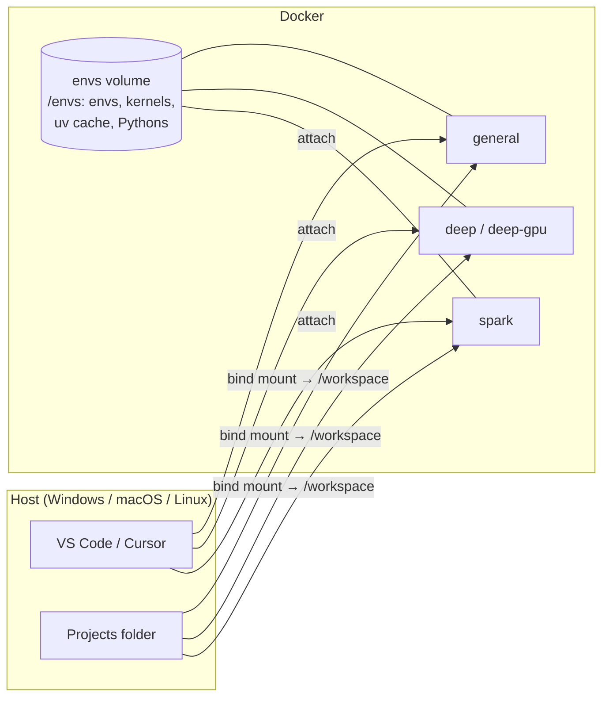

# DS Workbench — Docker + uv

Reproducible data science containers for **general ML**, **deep learning** and **Spark**. They all use the same skeleton, and you manage them with `docker compose` and a few `uv`-based helpers. They work on Windows, macOS and Linux, and with VS Code or Cursor.

| Service    | Use for                         | Extra vs. base           | Jupyter (host)          |
|------------|---------------------------------|--------------------------|-------------------------|
| `general`  | pandas, sklearn, xgboost, MLflow | —                        | http://localhost:8888   |
| `deep`     | PyTorch, 🤗 Transformers (CPU)   | larger shared memory     | http://localhost:8889   |
| `deep-gpu` | same as `deep` + NVIDIA GPU      | GPU reservation          | http://localhost:8889   |
| `spark`    | PySpark (local mode)            | Java 17, Spark UI :4040  | http://localhost:8890   |

---

## 1. Design

### What changed and why

| Before | Now | Why |
|---|---|---|
| 3 different Dockerfiles + a Mac copy | **1 Dockerfile**, profiles differ only by build args | One place to maintain; multi-arch base image works on Apple Silicon too |
| Packages `pip install`ed into the image | **Image has no project packages**; envs live in a volume (`/envs`) | Adding a package never needs a rebuild; images stay small and build in minutes |
| One global Python per container | **One uv env per project**, each a Jupyter kernel | No version clashes between projects; any Python version (3.9–3.13) in any container |
| `nvidia/cuda` base image | Plain `python:slim` | PyTorch wheels bundle CUDA; the host only needs the driver |
| Long `docker run` commands per OS | `docker compose up -d <service>` | Same command on every OS; config lives in a file |
| `--net=host`, Jupyter on 0.0.0.0, `sudo jupyter --allow-root` | Ports bound to `127.0.0.1`, Jupyter auto-starts as non-root | Works on Docker Desktop; nothing exposed to your network |
| `dos2unix` fixes | `.gitattributes` forces LF line endings | Scripts don't break on Windows clones |

### Architecture



- **Container = system capabilities** (OS tools, Java, GPU). It is thrown away and rebuilt freely.
- **Env = Python packages** (in `/envs/<name>`). All containers share it, and it survives rebuilds.
- **Code = your host folder** (at `/workspace`). Docker never owns it.

Inside each container:

```
/workspace         your projects (host folder)
/envs/<name>       one uv env per project            ┐
/envs/.jupyter     registered kernels                │ one named volume, `dsw_envs`
/envs/.cache       uv download cache (hardlinked)    │
/envs/.python      uv-managed Python versions        ┘
/opt/jupyter       the Jupyter server's own env (don't install into it)
```

> Never create a `.venv` inside `/workspace`. On Windows and macOS, a bind mount is far slower than a volume. `mkenv` and `actenv` handle this for you.

---

## 2. Prerequisites

| | Windows | macOS | Linux |
|---|---|---|---|
| Docker | Docker Desktop (WSL 2 backend) | Docker Desktop | Docker Engine + Compose plugin; `sudo usermod -aG docker $USER` |
| IDE | VS Code + **Dev Containers** extension, or Cursor (built-in) | same | same |
| GPU (optional) | NVIDIA driver | not supported, use `deep` | NVIDIA driver + [NVIDIA Container Toolkit](https://docs.nvidia.com/datacenter/cloud-native/container-toolkit/latest/install-guide.html) |

Check: `docker compose version` should print v2.24 or newer.

---

## 3. Setup (once)

The same commands work in PowerShell, Terminal or bash.

```bash
# 1. Clone into the folder that holds your projects (that folder becomes /workspace)
cd <your-projects-folder>
git clone https://github.com/sush4nt/docker-containers.git
cd docker-containers

# 2. Optional: copy the config template and edit it (workspace path, ports, UID, private index)
cp .env.example .env

# 3. Build and start a workbench
docker compose up -d general          # or: deep | deep-gpu | spark

# 4. Watch the first start: it builds the default env + kernel (`general`, `deep` or `spark`)
docker compose logs -f general        # wait for "✓ general ready", then Ctrl+C
```

Settings in `.env`:

| Variable | When to set it |
|---|---|
| `WORKSPACE_DIR` | Your projects aren't in the folder above this repo |
| `USER_UID` / `USER_GID` | Linux only, if `id -u` isn't `1000`. Rebuild afterwards |
| `GENERAL_PORT`, `DEEP_PORT`, `SPARK_PORT` | A port is already in use |
| `UV_INDEX` | Private package index (Artifactory and similar) |

> **Windows speed tip:** files under `C:\` are slow through Docker. For the best I/O, keep projects in WSL (`\\wsl$\Ubuntu\home\<you>\projects`) and run the commands from a WSL terminal.

---

## 4. Connect VS Code or Cursor

**Option A: attach (recommended)**
1. `docker compose up -d general`
2. Press `Ctrl/Cmd+Shift+P` and run **Dev Containers: Attach to Running Container…**, then pick `dsw-general`.
3. Use **File → Open Folder → `/workspace`**.

The Python and Jupyter extensions, plus `python.venvPath=/envs`, are applied automatically from the image label.

**Option B: reopen in container**
Open this repo folder, then run **Dev Containers: Reopen in Container** and pick `dsw-general`, `dsw-deep`, `dsw-deep-gpu` or `dsw-spark`. It starts the service and opens `/workspace`. Closing the window leaves the container running.

**Pick a kernel in a notebook:** click **Select Kernel → Jupyter Kernel…** and choose `<name> (py3.x)`.
Alternatives:
- **Python Environments → /envs/<name>**
- **Existing Jupyter Server → `http://localhost:8888`** (from inside an attached window, it's always 8888)

**Browser instead of an IDE:** use the host port from the table at the top.

**Other ports** (Streamlit, MLflow, Dash, …): VS Code and Cursor auto-forward any port you start inside the container. To reach them from a browser without an IDE, add them under `ports:` in [compose.yaml](compose.yaml).

---

## 5. Environments and kernels

Each env is an isolated uv venv in `/envs/<name>`, registered as the Jupyter kernel `<name> (pyX.Y)`.

| Task | Command (inside the container) |
|---|---|
| Create env + kernel from `./requirements.txt` or `./pyproject.toml` | `cd /workspace/myproj && mkenv myproj 3.11` |
| Create from a specific file / project dir | `mkenv myproj 3.12 /workspace/myproj/sub/requirements.txt` |
| Update after requirements change (safe to re-run) | `mkenv myproj 3.11` |
| Change Python version / clean rebuild | `rmenv myproj && mkenv myproj 3.12` |
| List envs, Python version, kernel status | `lsenv` |
| List kernels | `jupyter kernelspec list` |
| Activate in a terminal | `actenv myproj` (`deactivate` to leave) |
| Run without activating | `/envs/myproj/bin/python train.py` |
| Remove env + kernel | `rmenv myproj` |
| Start tmux layout (shell \| htop / Jupyter log) | `work` (prefix `Ctrl+a`; `Ctrl+a d` detaches) |

From the host, without opening a shell:

```bash
docker compose exec -w /workspace/myproj general mkenv myproj 3.11
docker compose exec general bash          # interactive shell
```

How `mkenv` reads its source:
- **`requirements.txt`**: runs `uv pip install -r`. Re-running adds and upgrades packages but doesn't remove extras.
- **`pyproject.toml`**: runs `uv sync` into `/envs/<name>`. This writes or uses `uv.lock` (commit it) and installs your project as editable.

Envs are shared by all services. You can open a `deep` env from the `general` container, for example. Spark sessions still need the `spark` container (Java), and CUDA needs `deep-gpu`.

---

## 6. Adding packages (no rebuild, no restart)

```bash
addpkg myproj polars "lightgbm>=4"                  # PyPI
addpkg myproj -r requirements-extra.txt             # requirements file
addpkg myproj -U pandas                             # upgrade
addpkg myproj -e /workspace/my-lib                  # your own package, editable (live code changes)
addpkg myproj "git+https://github.com/org/repo.git@v1.2"   # git (SSH works in IDE terminals via agent forwarding)
addpkg myproj dst --index https://<private-index>/simple    # private index, one-off
uv pip list   --python /envs/myproj                 # what's installed
uv pip freeze --python /envs/myproj > requirements.lock     # pin exact versions
```

`addpkg <env> …` is `uv pip install --python /envs/<env> …`, so any uv/pip flag works.

- **Private index for every install:** set `UV_INDEX=...` in `.env`, then run `docker compose up -d <service>`. Put credentials in the URL; `.env` is git-ignored.
- **pyproject projects:** run `actenv myproj`, then `uv add pandas` / `uv remove pandas` / `uv sync`. `actenv` points uv at `/envs/myproj`, so no `.venv` is created.
- **In a notebook:** `!addpkg myproj pkg` or `%pip install pkg`. New packages import immediately. Restart the kernel only after upgrading a package that's already imported.

---

## 7. Daily workflow

```text
Start     docker compose up -d general        (skip if already running: docker compose ps)
Attach    IDE → Attach to Running Container → dsw-general → open /workspace
New proj  cd /workspace/<proj> && mkenv <proj> 3.11   → pick kernel "<proj> (py3.11)"
Work      notebooks: select kernel · terminal: actenv <proj> · deps: addpkg <proj> <pkg>
Switch    docker compose up -d spark → attach dsw-spark (same envs, same files)
Stop      docker compose stop general          (or leave it running; idle cost is minimal)
```

---

## 8. Docker reference

### `docker run` vs `docker compose`

| | `docker run` | `docker compose` |
|---|---|---|
| Configuration | Flags typed every time, and they differ per OS (`\` vs `` ` ``) | Written once in `compose.yaml`, versioned in git |
| Several containers / volumes / ports | Manual and error-prone | Declared together and created automatically |
| Start again later | `docker start` + `docker attach` (exiting the shell can stop it) | `docker compose up -d <svc>`; the container keeps running in the background |
| Rebuild after a Dockerfile change | `docker build` + remove + re-run | `docker compose up -d --build <svc>` |

### Commands

| Task | Command |
|---|---|
| Start / create | `docker compose up -d <svc>` |
| Rebuild after Dockerfile change | `docker compose up -d --build <svc>` |
| Clean rebuild (no layer cache) | `docker compose build --no-cache <svc> && docker compose up -d <svc>` |
| Status | `docker compose ps` |
| Logs (startup, env bootstrap) | `docker compose logs -f <svc>` |
| Jupyter log | `docker compose exec <svc> tail -f /tmp/jupyter.log` |
| Shell | `docker compose exec <svc> bash` |
| Stop one / all (keeps everything) | `docker compose stop <svc>` / `docker compose down` |
| ⚠️ Delete all envs, kernels, cache | `docker compose down -v` |
| Disk usage / clean build cache | `docker system df` / `docker builder prune` |

> Always name the service. A bare `docker compose up -d` starts all four, and `deep-gpu` fails on machines without an NVIDIA GPU.

### What survives what

| Event | `/workspace` code | `/envs` envs + kernels + cache |
|---|---|---|
| Close IDE, `stop`, `down`, PC restart | ✅ | ✅ |
| `up -d --build`, editing the Dockerfile | ✅ | ✅ |
| `down -v` | ✅ | ❌ deleted |

---

## 9. Why uv

- **Fast:** resolves and installs 10–100× faster than pip. Re-creating an env from cache takes seconds.
- **Correct:** a real dependency resolver, and `uv.lock` for exact, cross-platform reproducibility.
- **Python versions included:** `mkenv x 3.9` downloads Python 3.9 on demand. You don't need a base image per version.
- **Disk-efficient:** one cache shared by all envs and hardlinked into them, so ten envs with PyTorch don't store ten copies.
- **Familiar:** `uv pip …` accepts pip's syntax, and `uv add/sync` handles `pyproject.toml` projects.

---

## 10. Customizing

| Change | How |
|---|---|
| Default packages of a profile | Edit `profiles/<profile>/requirements.txt`, then inside the container run `mkenv <profile> 3.12 /opt/profiles/<profile>/requirements.txt` (no rebuild; the folder is mounted) |
| System package for all containers | Add it to the `apt-get install` list in [docker/Dockerfile](docker/Dockerfile), then run `docker compose up -d --build <svc>` |
| System package for one profile | Set the `EXTRA_APT` build arg for that service in [compose.yaml](compose.yaml) (see `spark`) |
| New profile (e.g. `nlp`) | Copy a service block in `compose.yaml` (new name, `DEFAULT_ENV`, port) + add `profiles/nlp/requirements.txt` + `.devcontainer/nlp/devcontainer.json` |
| Skip the default env | Set `DEFAULT_ENV=` (empty) under the service's `environment:` |
| Jupyter password | Set `JUPYTER_TOKEN=...` in `.env` |

TensorFlow and PyTorch conflict over CUDA libraries when installed together, so give TensorFlow its own env: `mkenv tf 3.12`, then `addpkg tf "tensorflow[and-cuda]"`.

Check the GPU (in `deep-gpu`): `/envs/deep/bin/python -c "import torch; print(torch.cuda.is_available())"`.

---

## 11. Troubleshooting

| Symptom | Fix |
|---|---|
| Kernel missing in the picker | Run `lsenv`. If KERNEL shows `no`, re-run `mkenv <name> <py>`, then refresh the picker or reload the window |
| Default env failed on first start | `docker compose logs <svc>`, fix `profiles/<svc>/requirements.txt`, then `docker compose exec <svc> mkenv <svc> 3.12 /opt/profiles/<svc>/requirements.txt` |
| `Permission denied` in `/workspace` (Linux) | Set `USER_UID`/`USER_GID` in `.env` to your `id -u`/`id -g`, then `docker compose up -d --build <svc>` |
| `port is already allocated` | Change `*_PORT` in `.env`, or stop the other container |
| `could not select device driver "nvidia"` | No GPU runtime on this host. Use `deep`, or install the NVIDIA Container Toolkit |
| `$'\r': command not found` | A script was saved with Windows line endings. The image strips them at build time, so run `docker compose up -d --build <svc>` |
| Spark: `JAVA_GATEWAY_EXITED` | You're not in the `spark` container. Check with `java -version` |
| Kernel connection hangs in VS Code | Select **Existing Jupyter Server → `http://localhost:8888`** |
| Start completely fresh | `docker compose down -v && docker compose up -d --build <svc>` (deletes all envs) |

---

## Repository layout

For a file-by-file explanation of what each file does and who reads it, see [STRUCTURE.md](STRUCTURE.md).

```
compose.yaml              services: general, deep, deep-gpu, spark
.env.example              per-machine settings (copy to .env)
docker/
  Dockerfile              the single image skeleton
  entrypoint.sh           starts Jupyter, builds the default env on first start
  bashrc.sh               actenv, work (tmux), tab completion
  tmux.conf
  bin/                    mkenv, rmenv, lsenv, addpkg
profiles/<profile>/requirements.txt   default env per container
.devcontainer/<service>/  "Reopen in Container" configs
deprecated/               previous Dockerfiles and README (reference only)
```
