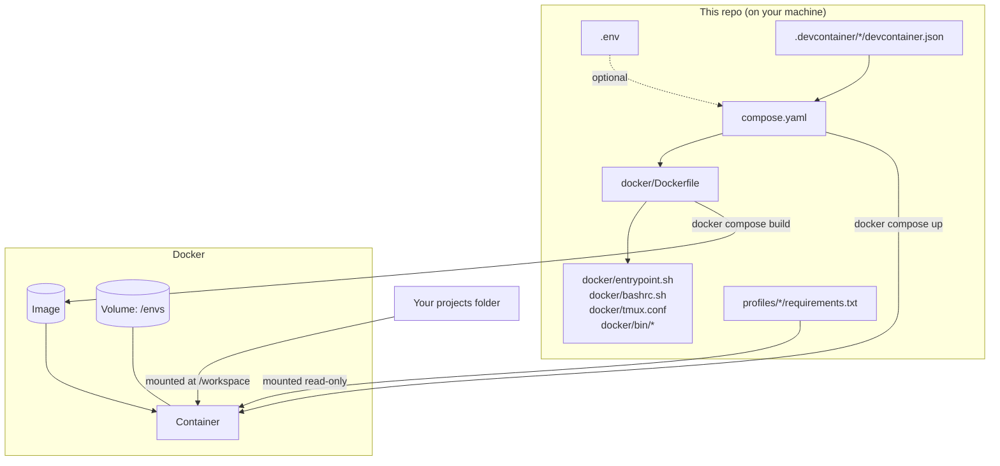
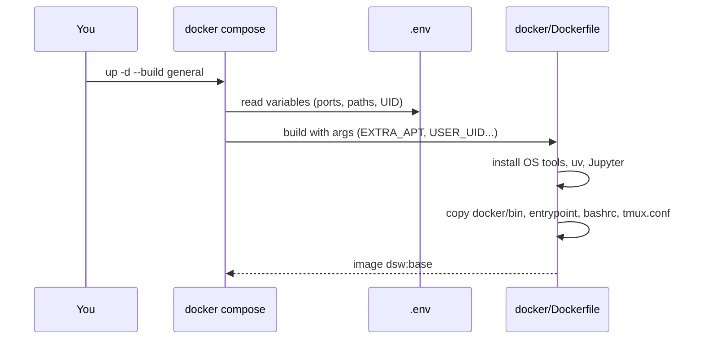
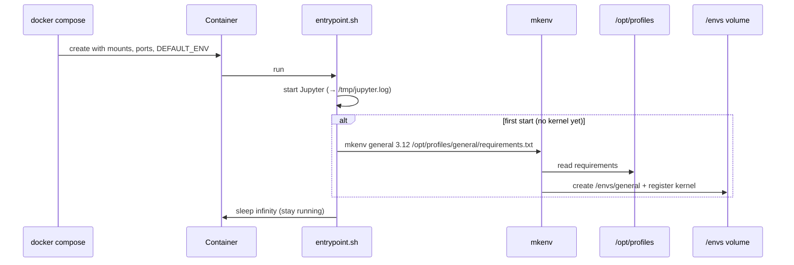
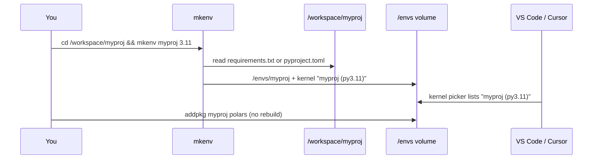

# Repository Structure — What Lives Where and Who Uses It

This guide explains every file in the repo: what it is for, **who reads it** and **when**. Use [README.md](README.md) for setup and daily commands. Use this document to find your way around and understand how the pieces connect.

---

## 1. The big picture

The repo produces three things:

| Layer | What it is | Built from | Lifetime |
|---|---|---|---|
| **Image** | A read-only template: OS, tools, uv, the Jupyter server, helper scripts | `docker/` | Rebuilt whenever the Dockerfile changes |
| **Container** | A running copy of the image, with ports, mounts and GPU attached | `compose.yaml` (+ `.env`) | Created, stopped and recreated freely |
| **Volume `dsw_envs`** | Your Python environments, kernels, uv cache and Python versions | Created at runtime by `mkenv` | Survives everything except `docker compose down -v` |

Your **project code** isn't part of any of these. It stays on your machine and is only *mounted* into the container.



---

## 2. Directory tree (annotated)

```
docker-containers/
│
├── README.md                    How to set up and use the workbench (start here)
├── STRUCTURE.md                 This file: what each file is and who uses it
│
├── compose.yaml                 Defines the 4 services (general, deep, deep-gpu, spark)
├── .env.example                 Template for per-machine settings → copy to .env
├── .env                         (you create it; git-ignored) your paths, ports, private index
│
├── docker/                      Everything that goes INTO the image
│   ├── Dockerfile               The single recipe used by every service
│   ├── entrypoint.sh            Runs on every container start
│   ├── bashrc.sh                Shell functions: actenv, work, tab-completion
│   ├── tmux.conf                tmux key bindings and look
│   └── bin/                     Commands available inside the container
│       ├── mkenv                Create/update an env + register its Jupyter kernel
│       ├── rmenv                Delete an env + its kernel
│       ├── lsenv                List envs, Python versions, kernel status
│       └── addpkg               Install packages into an env
│
├── profiles/                    Default package lists, one per container type
│   ├── general/requirements.txt
│   ├── deep/requirements.txt
│   └── spark/requirements.txt
│
├── .devcontainer/               "Reopen in Container" configs for VS Code / Cursor
│   ├── general/devcontainer.json
│   ├── deep/devcontainer.json
│   ├── deep-gpu/devcontainer.json
│   └── spark/devcontainer.json
│
├── .github/workflows/ci.yaml    GitHub Actions: builds images and smoke-tests them
├── .gitattributes               Forces LF line endings (keeps scripts working on Windows)
├── .gitignore                   Ignores .env and notebook checkpoints
│
└── deprecated/                  Old setup, kept for reference only. Nothing reads it
```

---

## 3. File-by-file

Each entry answers: **what it is**, **who reads it**, **when** it's read, and **edit it when**.

### Top level

#### `compose.yaml`
- **What:** The control panel. It declares the four services and, for each one, which image to build, which ports to open, which folders to mount and which default env to create.
- **Read by:** `docker compose` on your machine, and Dev Containers in VS Code/Cursor through `.devcontainer/*`.
- **When:** Every `docker compose ...` command.
- **Key parts:**

  | Block | Meaning |
  |---|---|
  | `name: dsw` | Project name. Prefixes the volume (`dsw_envs`) and groups the containers |
  | `x-common` | Shared settings that every service copies (build, mounts, `.env`) |
  | `services.general / deep / deep-gpu / spark` | The four workbenches; they differ only in ports, `DEFAULT_ENV`, GPU and Java |
  | `volumes: envs` | The one persistent volume, mounted at `/envs` |
- **Edit it when:** adding a service, opening an extra port, or changing GPU settings.

#### `.env.example` → `.env`
- **What:** Per-machine settings: projects folder, Linux user ID, ports, Jupyter token, private package index.
- **Read by:** `docker compose`, in two ways:
  1. To fill in `${VARIABLES}` in `compose.yaml` (e.g. `WORKSPACE_DIR`, `GENERAL_PORT`).
  2. Through `env_file`, which passes every variable into the container (e.g. `UV_INDEX`, which uv reads inside).
- **When:** Every `docker compose up` / `build`.
- **Edit it when:** first setup, or when moving to a new machine. Never commit `.env`; it may contain credentials.

#### `README.md`
The user manual: setup, IDE connection, env and package commands, Docker reference, troubleshooting.

---

### `docker/` — what goes into the image

All of these are **copied into the image** at build time. Changing any of them requires `docker compose up -d --build <service>`.

#### `docker/Dockerfile`
- **What:** The single build recipe for every container type.
- **Read by:** `docker compose build` (pointed at it from `compose.yaml → build.dockerfile`).
- **Steps, in order:**

  | Step | Result inside the image |
  |---|---|
  | `FROM python:...-slim-bookworm` | Base OS + system Python |
  | `apt-get install ... ${EXTRA_APT}` | Tools (git, tmux, htop, vim, ...) + profile extras (Java for spark) |
  | `useradd devuser` | Non-root user with passwordless sudo |
  | `COPY --from=uv` | `uv` and `uvx` in `/usr/local/bin` |
  | `uv venv /opt/jupyter` | The Jupyter server's own private env |
  | `COPY docker/...` | Scripts placed in `/opt/dsw/` (see path map below) |
  | `ENV UV_...` | Tells uv to keep its cache and Pythons in `/envs` |
  | `ln -s ... kernels` | Kernel registrations are stored in `/envs` (so they persist) |
  | `LABEL devcontainer.metadata` | Tells VS Code/Cursor which extensions and settings to apply on attach |
  | `ENTRYPOINT` / `CMD` | Run `entrypoint.sh`, then stay alive with `sleep infinity` |
- **Build args** (set in `compose.yaml`): `EXTRA_APT`, `USER_UID`, `USER_GID`, plus `PYTHON_VERSION` and `UV_VERSION` (defaults are fine).

#### `docker/entrypoint.sh`
- **What:** The start-up script.
- **Read by:** Docker, automatically, every time a container starts.
- **Does:**
  1. Makes sure `/envs` is writable.
  2. Starts the Jupyter server in the background → log at `/tmp/jupyter.log`.
  3. **First start only:** runs `mkenv` to build the default env (`DEFAULT_ENV` from `compose.yaml`) from `profiles/<name>/requirements.txt`.
  4. Hands over to `CMD` (`sleep infinity`), which keeps the container running.
- **See its output:** `docker compose logs -f <service>`.

#### `docker/bashrc.sh`
- **What:** Shell functions that must live in your shell rather than run as separate programs.
- **Read by:** Every interactive bash shell in the container (sourced from `~/.bashrc`).
- **Provides:**
  - `actenv <env>`: activates an env and points `uv add/sync` at it.
  - `work`: opens the tmux layout.
  - Tab-completion of env names for `actenv`, `rmenv` and `addpkg`.

#### `docker/tmux.conf`
- **What:** tmux settings (prefix `Ctrl+a`, mouse, split keys, status bar).
- **Read by:** tmux, when you run `work` or `tmux`.

#### `docker/bin/*` — the env commands
Plain scripts on the container's `PATH`. You can call them from any shell, or from the host with `docker compose exec <svc> <command>`.

| Script | Reads | Writes |
|---|---|---|
| `mkenv <name> [py] [src]` | `requirements.txt` or `pyproject.toml` (given path, or current folder) | `/envs/<name>/`, `/envs/.jupyter/kernels/<name>/`, `uv.lock` (pyproject projects only) |
| `addpkg <name> <args>` | `/envs/<name>/` | `/envs/<name>/` |
| `lsenv` | `/envs/*/pyvenv.cfg`, `/envs/.jupyter/kernels/` | — |
| `rmenv <name>` | — | deletes `/envs/<name>/` and its kernel |

All of them use **uv** underneath and the shared cache in `/envs/.cache`.

---

### `profiles/` — default package lists

- **What:** One `requirements.txt` per container type. Each one is the *starting* env for that container (`general`, `deep`, `spark`).
- **Read by:** `mkenv`, called by `entrypoint.sh` on first start (or by you when updating).
- **How it gets in:** **mounted read-only** at `/opt/profiles`, not copied into the image. Editing a file here needs **no rebuild**. Just re-run inside the container:
  ```bash
  mkenv general 3.12 /opt/profiles/general/requirements.txt
  ```
- **Note:** Project-specific packages don't belong here. Give each project its own env with `mkenv <project>`.

---

### `.devcontainer/` — IDE integration

- **What:** One small JSON per service, listed in VS Code/Cursor's **Reopen in Container** picker.
- **Read by:** The Dev Containers extension (VS Code) or Cursor's built-in equivalent.
- **Does:** Points to `../../compose.yaml`, starts only that service, opens `/workspace`, and leaves the container running when you close the window.
- **Not needed for "Attach to Running Container".** That path uses the `LABEL` in the Dockerfile instead.

---

### Repo housekeeping

| File | Read by | Purpose |
|---|---|---|
| `.github/workflows/ci.yaml` | GitHub Actions on every push/PR | Builds `general` + `spark`, checks key imports, runs a Spark job, and tests `mkenv`/`addpkg`/`lsenv`/`rmenv` |
| `.gitattributes` | git, on checkout | Keeps LF line endings so shell scripts run on Windows clones |
| `.gitignore` | git | Keeps `.env` (secrets) and notebook checkpoints out of the repo |

### `deprecated/`
The previous generation: separate Dockerfiles per container, `docker run` instructions and the old README. **Nothing in the new setup reads these files.** They're kept only for reference and can be deleted once you no longer need them.

---

## 4. Path map — repo file → location inside the container

| On your machine | Inside the container | How it gets there |
|---|---|---|
| Your projects folder (`WORKSPACE_DIR`, default: parent of this repo) | `/workspace` | bind mount (live, two-way) |
| `profiles/` | `/opt/profiles` | bind mount (live, read-only) |
| `docker/entrypoint.sh`, `docker/bashrc.sh` | `/opt/dsw/` | copied at build |
| `docker/bin/*` | `/opt/dsw/bin/` (on `PATH`) | copied at build |
| `docker/tmux.conf` | `/home/devuser/.tmux.conf` | copied at build |
| `.env` values | environment variables | `env_file` at start |
| — | `/envs` | named volume `dsw_envs` |

**Bind mount vs copied:** editing a *mounted* file takes effect immediately. Editing a *copied* file needs a rebuild.

---

## 5. Runtime-only locations (not in the repo)

These are created while you work, so you won't find them in git:

```
/envs/                                  ← named volume "dsw_envs", shared by all containers
├── <env-name>/                         one uv virtual env per project (created by mkenv)
│   ├── bin/python                      the interpreter your kernel/scripts use
│   └── pyvenv.cfg                      Python version (read by lsenv)
├── .jupyter/kernels/<env-name>/        kernel registration (kernel.json → /envs/<env-name>/bin/python)
├── .cache/                             uv download/build cache (hardlinked into envs)
└── .python/                            Python versions downloaded by uv (3.9, 3.11, ...)

/home/devuser/.local/share/jupyter/kernels  → symlink to /envs/.jupyter/kernels
/opt/jupyter/                           Jupyter server env (part of the image, don't install into it)
/tmp/jupyter.log                        Jupyter server log (lost when the container is recreated)
```

---

## 6. How the files work together

### Build time — `docker compose up -d --build general`



### Start time — container boots



### Daily use — new project



### IDE connection

| Method | Uses |
|---|---|
| Attach to Running Container | Running container + `LABEL devcontainer.metadata` in the Dockerfile |
| Reopen in Container | `.devcontainer/<svc>/devcontainer.json` → `compose.yaml` |
| Existing Jupyter Server | Jupyter started by `entrypoint.sh` on port 8888 |

---

## 7. "I want to change X" → edit this

| Goal | Edit | Then run |
|---|---|---|
| Different projects folder | `.env` → `WORKSPACE_DIR` | `docker compose up -d <svc>` |
| Different host port | `.env` → `*_PORT` | `docker compose up -d <svc>` |
| Private package index | `.env` → `UV_INDEX` | `docker compose up -d <svc>` |
| Default packages of a container type | `profiles/<type>/requirements.txt` | `mkenv <type> 3.12 /opt/profiles/<type>/requirements.txt` (inside) |
| Packages for one project | nothing in this repo | `addpkg <env> <pkg>` (inside) |
| OS tool for all containers | `docker/Dockerfile` (apt list) | `docker compose up -d --build <svc>` |
| OS tool for one container type | `compose.yaml` → that service's `EXTRA_APT` | `docker compose up -d --build <svc>` |
| Behaviour of `mkenv`/`rmenv`/... | `docker/bin/<script>` | `docker compose up -d --build <svc>` |
| Shell shortcuts / tmux layout | `docker/bashrc.sh` | `docker compose up -d --build <svc>` |
| tmux keys / colours | `docker/tmux.conf` | `docker compose up -d --build <svc>` |
| Start-up behaviour | `docker/entrypoint.sh` | `docker compose up -d --build <svc>` |
| New container type | `compose.yaml` + `profiles/<new>/` + `.devcontainer/<new>/` | `docker compose up -d <new>` |
| IDE extensions on attach | `docker/Dockerfile` → `LABEL devcontainer.metadata` | `docker compose up -d --build <svc>` |
| CI checks | `.github/workflows/ci.yaml` | push to GitHub |

Rule of thumb:
- **`docker/` changed** → rebuild.
- **`compose.yaml` or `.env` changed** → `up -d`.
- **`profiles/` changed** → re-run `mkenv`.
- **Project packages** → `addpkg`; nothing in the repo changes.
